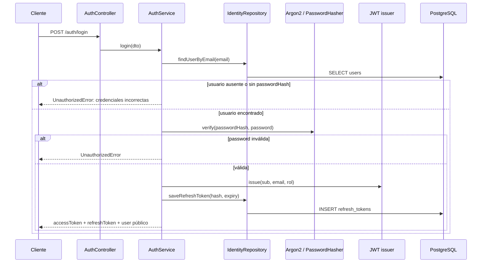

# Caso de uso: autenticación y sesión

> **Estado:** comportamiento implementado y trazado desde el código.

## Entradas principales

| Endpoint | Seguridad | Resultado implementado |
|---|---|---|
| `POST /auth/register` | Pública | Crea usuario y devuelve access/refresh tokens. |
| `POST /auth/login` | Pública | Verifica email/contraseña y devuelve tokens. |
| `POST /auth/request-otp` | Pública, 8/min | Guarda OTP hash y publica solicitud de correo. |
| `POST /auth/verify-otp` | Pública, 8/min | Consume OTP; emite tokens o indica `requiresRegistration`. |
| `POST /auth/request-password-reset` | Pública, 8/min | Respuesta uniforme; si existe usuario publica enlace. |
| `POST /auth/reset-password` | Pública, 8/min | Actualiza contraseña e invalida refresh tokens. |
| `POST /auth/refresh` | Pública | Rota un refresh token válido. |
| `GET /auth/me` | JWT | Devuelve usuario público. |
| `POST /auth/logout` | JWT | Elimina refresh tokens del usuario. |

## Flujo de login

## Registro y eventos

`register` rechaza emails existentes con `ConflictError`, genera el hash de
contraseña con el puerto `PASSWORD_HASHER` y crea el usuario dentro de una
unidad de trabajo. Publica `UsuarioRegistrado` dentro de la transacción; el
contexto de pedidos enlaza pedidos de invitado con el mismo email y
`notifications` envía el correo de bienvenida después del commit.

## OTP y recuperación

El OTP se genera con seis dígitos, se guarda como hash y vence en 10 minutos.
La solicitud responde siempre con el mismo mensaje, incluso si el correo no
existe. Los resets generan un token aleatorio, almacenan su hash con expiración
de 15 minutos, publican un enlace al `FRONTEND_URL` configurado y, al usarse,
actualizan la contraseña, marcan el token como usado y eliminan sesiones activas.

## Evidencia de seguridad

`JwtAuthGuard` protege los endpoints privados; `RolesGuard` aplica los roles
declarados. El throttling de rutas sensibles se declara con `@Throttle`. La
configuración global de `ValidationPipe` elimina propiedades no permitidas y
transforma tipos.
