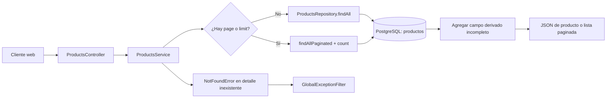

# Caso de uso: consultar y administrar el catálogo

> **Estado:** comportamiento implementado y trazado desde el código. La lectura del frontend externo no se inspeccionó.

## Entradas

- `GET /products` — público; filtros DTO opcionales: categoría, marca, género,
  rango de precio, disponibilidad, destacado, orden y paginación.
- `GET /products/:id` — público; recibe `id` de producto.
- `POST /products`, `PATCH /products/:id`, `DELETE /products/:id` — requieren
  JWT y rol `ADMIN`.

Los endpoints se registran en
[`ProductsController`](../../src/modules/products/infrastructure/http/products.controller.ts).
Los DTOs aplican la validación global de Nest mediante `ValidationPipe`.

## Flujo de lectura

## Comportamiento confirmado

1. `ProductsController` entrega el DTO de query a `ProductsService`.
2. Sin paginación explícita, el servicio llama `findAll`; con `page` o `limit`,
   calcula `skip`, usa `findAllPaginated` y retorna `data` más `meta` con
   `total`, `page`, `limit` y `totalPages`.
3. Cada producto se transforma con `estaIncompleto`, exponiendo el estado
   derivado `incompleto`.
4. El detalle usa `findUnique` por `id`; si no existe, el servicio lanza
   `NotFoundError`, que el filtro global traduce a HTTP.
5. El repositorio consulta el modelo Prisma `Product`, mapeado a la tabla
   `productos`.

## Mutaciones administrativas

`create`, `update` y `remove` verifican existencia cuando aplica, escriben por
el repositorio Prisma y registran un evento de auditoría mediante el puerto
`AUDIT_LOG` con acción `CREAR`, `EDITAR` o `ELIMINAR`. El actor se obtiene de
`CurrentUser`.

## Evidencia y límites

- **Verificado:** controller, service, repository, DTOs, modelo Prisma y guard
  de roles.
- **No verificado:** aspecto visual de las tarjetas, hover, filtros de la tienda
  o lectura directa de las vistas públicas desde el frontend, porque ese cliente
  no está en este repositorio.
