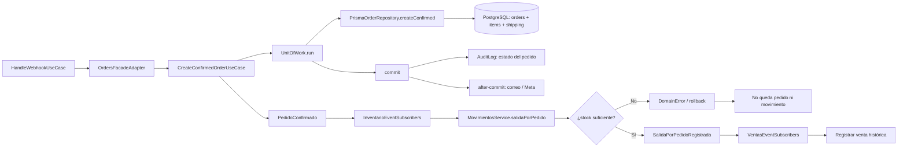

# Caso de uso: crear pedido confirmado y aplicar efectos transaccionales

> **Estado:** comportamiento implementado. Este documento describe la creación confirmada usada por el pago aprobado y el contrato de eventos; no propone un flujo nuevo.

## Entrada

`CreateConfirmedOrderUseCase` es invocado por `HandleWebhookUseCase` a través de
la fachada de pedidos cuando MercadoPago informa `APROBADO`. Recibe número de
pedido, items ya cotizados, subtotal, total, datos de envío, usuario opcional y
cookies Meta.

## Flujo

## Comportamiento confirmado

1. `UnitOfWork.run` abre el contexto transaccional.
2. El repositorio crea el pedido ya en `CONFIRMADO` con método
   `MERCADOPAGO`, sus líneas, snapshot de envío y cookies Meta.
3. Se publica `PedidoConfirmado` en la misma transacción.
4. Inventario escucha el evento y registra la salida por pedido. Si no hay
   stock, lanza un error de dominio; la unidad de trabajo revierte la creación.
5. Cuando inventario confirma la salida, ventas registra la venta histórica y
   resuelve el costo de las unidades disponibles.
6. Después del commit, el caso de uso registra auditoría. Otros suscriptores
   `after-commit` manejan notificaciones y conversiones.

## Invariantes observadas

- El pedido de MercadoPago no nace antes de la aprobación cuando se usa
  `create-pending`.
- Inventario y ventas reaccionan a eventos públicos; pedidos no importa sus
  implementaciones internas.
- Los efectos de correo y Meta no bloquean la transacción de persistencia.

## Evidencia

[`create-confirmed-order.use-case.ts`](../../src/modules/orders/application/use-cases/create-confirmed-order.use-case.ts),
[`in-process-event-bus.ts`](../../src/shared/infrastructure/events/in-process-event-bus.ts),
suscriptores de `inventario`, `ventas`, `notifications` y `meta-conversions`, y
las pruebas del bus y del caso de uso.
